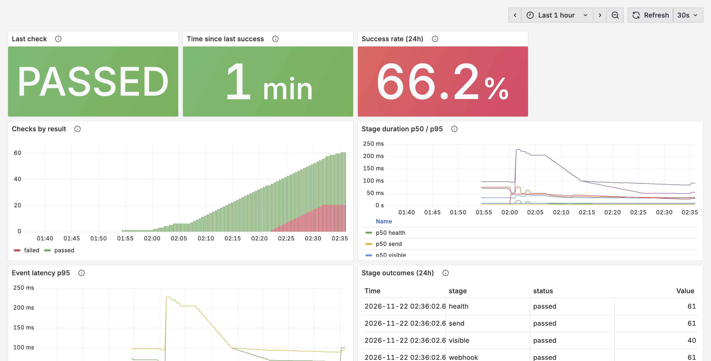

# hawk-synthetic-monitor

Synthetic monitoring for [Hawk](https://hawk.so). On a fixed interval the service sends a test event and checks that it makes it through the whole pipeline: collector, processing, the project view in the API, and the notification Hawk delivers through a webhook. Every stage is timed. When a check fails, the service says which stage failed and alerts a Telegram chat.

Test assignment for the CodeX club (Developer Infrastructure, Synthetic Monitoring).

## What one check does

```
health   GET  collector /health               redis and mongo reported healthy
send     POST collector /                     event with a unique title, accepted (HTTP 200, error:false)
visible  POST API /graphql                    the event with that title shows up in the project's events
webhook  POST <monitor>/webhook (from Hawk)   Hawk's notifier delivers the event to our receiver
```

- `visible` and `webhook` run in parallel after `send`; each has its own deadline counted from the moment of sending, so a failed webhook does not hide that the event was processed (and the other way round).
- The webhook receiver is subscribed **before** the event is sent, so a very fast notification is never lost.
- If `health` or `send` fails, the later stages are recorded as `skipped` with a reason.
- Each stage records status, duration, attempts and a failure code (`timeout`, `unavailable`, `not_found`, `error`). Temporary network failures, 5xx and 429 are retried within the stage budget.
- Only one check runs at a time. A tick that finds a run still active is skipped; a manual `POST /run` gets `409`.

What the result tells you:

| Failed stage | Meaning |
|---|---|
| `health` | collector, Redis or its MongoDB are down |
| `send` | the collector rejected or did not answer (bad token 400, limit 402, 429, 5xx, network) |
| `visible` | no event in the API in time: stuck somewhere in default/grouper/MongoDB, or the API is down |
| `webhook` | the event is visible, but no notification arrived: notifier, `sender/webhook` worker, or the receiver is unreachable from Hawk |

A timeout shows where the event stopped being observable. It does not by itself prove which worker is at fault.

Known limits: the API is polled for the project's latest 20 events, so use a dedicated project (the default `bootstrap.sh` project is one) and not one that receives heavy traffic; a retried `send` after a lost answer may create a second event with the same title (Hawk groups them, so it does not trigger a second notification); the webhook receiver accepts any POST with the right project id and title, but the title contains a random run id that only Hawk and the monitor know.

## Run it

You need a running Hawk (collector, API, and the `default`, `grouper`, `notifier` and `webhook` workers) and a project in it. The service never creates accounts or projects itself; `scripts/bootstrap.sh` does that once.

```sh
# 1. Prepare a project and an env file (local Hawk with the API in NODE_ENV=e2e, see "Hawk setup")
WEBHOOK_MODE=mongo HAWK_COMPOSE_DIR=/path/to/hawk.mono OUT=.env scripts/bootstrap.sh

# 2. Add the Telegram URL (optional) and start
echo 'TELEGRAM_NOTIFY_URL=https://notify.bot.codex.so/u/XXXX' >> .env
docker compose up -d --build

# 3. Look
curl localhost:8080/healthz
curl -X POST localhost:8080/run          # run a check now, returns the stage-by-stage result
curl localhost:8080/runs                 # history
curl localhost:8080/stats                # success rate for 24 h and 7 d
curl localhost:8080/metrics              # Prometheus
```

Without Docker: `go run ./cmd/monitor` with the same variables exported (see `.env.example`).

### Endpoints

| Path | Port | Purpose |
|---|---|---|
| `GET /healthz` | 8080 | liveness of the monitor itself (does not depend on Hawk) |
| `POST /run` | 8080 | run a check now |
| `GET /runs?limit=N` | 8080 | latest results (default 20, max 100) |
| `GET /stats` | 8080 | counts and success rate for the last 24 h and 7 days |
| `GET /metrics` | 8080 | Prometheus metrics, prefix `hawk_monitor_` |
| `POST /webhook` | 8085 | receiver for Hawk's webhook notifications |

### Configuration

Required: `HAWK_COLLECTOR_URL`, `HAWK_API_URL`, `HAWK_PROJECT_ID`, `HAWK_INTEGRATION_TOKEN`, `HAWK_EMAIL`, `HAWK_PASSWORD`. Everything else is optional; defaults are in `.env.example`:

| Variable | Default | |
|---|---|---|
| `MONITOR_INTERVAL` | `10m` | time between checks |
| `MONITOR_RUN_TIMEOUT` | `90s` | the whole check |
| `MONITOR_HEALTH_TIMEOUT` / `MONITOR_SEND_TIMEOUT` | `10s` / `15s` | per stage |
| `MONITOR_VISIBLE_TIMEOUT` / `MONITOR_WEBHOOK_TIMEOUT` | `30s` / `30s` | counted from sending |
| `MONITOR_POLL_INTERVAL` | `500ms` | how often the API is polled for the event |
| `MONITOR_MAX_ATTEMPTS` | `3` | attempts per stage for transient errors |
| `MONITOR_CLEANUP` | `false` | delete the test event after a passed check |
| `MONITOR_HTTP_ADDR` / `MONITOR_WEBHOOK_ADDR` | `:8080` / `:8085` | listen addresses |
| `MONITOR_DB_PATH` | `monitor.db` (`/data/monitor.db` in Docker) | SQLite history |
| `TELEGRAM_NOTIFY_URL` | empty | `@codex_bot` webhook URL (send `/notify_start` to the bot in a chat); empty disables alerts |
| `HEARTBEAT_URL` | empty | where to POST after every finished check (see the watchdog) |
| `RABBITMQ_MGMT_URL` | empty | RabbitMQ management API (e.g. `http://rabbitmq:15672`); set it to collect diagnostics on failures |
| `RABBITMQ_USER` / `RABBITMQ_PASSWORD` / `RABBITMQ_VHOST` | `guest` / empty / `/` | management API credentials |
| `RABBITMQ_QUEUES` | `errors/default,grouper,notifier,sender/webhook` | queues on the event path to report |

Alerts: one message for every failed check, and one when the checks pass again after a failure. A failure to send an alert or to save the result is recorded in the result (`reporting_errors`) and never changes the verdict about Hawk.

### Diagnostics on failure

When a check fails and `RABBITMQ_MGMT_URL` is set, the monitor takes a snapshot of Hawk right after the failure: the collector health and, for each queue on the event path, how many messages wait and how many consumers listen. The snapshot is stored with the run (`diagnostics` in `GET /runs`) and summarised in the Telegram alert:

```
collector: ok
queues: errors/default 0 msgs 1 consumer, grouper 0 msgs 1 consumer, notifier 0 msgs 1 consumer, sender/webhook 4 msgs 0 consumers!
```

The management API needs a user with the `monitoring` tag and no vhost permissions (`rabbitmqctl add_user ...; rabbitmqctl set_user_tags <user> monitoring`); the default `guest` user only works from localhost. A queue with no consumers is marked with `!`: that is the stuck stage. Without the variable the snapshot is skipped and nothing else changes. The result of the optional cleanup is exposed as `cleanup` in the same output.

## Observability and a watcher for the monitor itself

Two optional compose profiles:

```sh
docker compose --profile observability up -d   # Prometheus :9090 and Grafana :3001 (anonymous viewer), dashboard "Hawk synthetic monitor" is provisioned
docker compose --profile watchdog up -d        # watchdog :8090
```



- **Metrics** (`/metrics`, prefix `hawk_monitor_`): runs by status, stage outcomes, stage duration and event latency histograms, timestamps of the last run and the last success. Labels come from fixed sets only; run ids and error texts are never labels.
- **Heartbeat**: with `HEARTBEAT_URL` set, the monitor POSTs `{status, run_id, finished_at}` after **every finished check, failed ones too**, so a failing Hawk is not mistaken for a dead monitor. The `watchdog` service (`cmd/watchdog`) alerts Telegram when no ping arrives for `WATCHDOG_TIMEOUT` (default 25 m, must exceed the check interval) and once more when pings resume. A watchdog on the same Docker host does not notice that host dying: run it elsewhere for that (it is the same image with `entrypoint: watchdog`; it only needs `TELEGRAM_NOTIFY_URL`).
- To try it: stop the monitor (`docker compose stop monitor`) and wait for the timeout; start it again to get the recovery message.
- `POST /run` has no authentication, so compose publishes the operations port on `127.0.0.1` only. Put a reverse proxy with authentication in front of it before exposing it.

## Hawk setup

What the monitor needs from Hawk:

1. A project and its integration token, plus a user that can read the project through the API (login and password; access tokens live 15 minutes and the client logs in again on its own).
2. A notification rule on that project: `ONLY_NEW`, channel `webhook`, pointing at the monitor's `/webhook`.
3. Reachability: the monitor must reach the collector and the API; Hawk's webhook worker must reach the monitor's `:8085`.

Two ways to create the webhook rule (`scripts/bootstrap.sh`, `WEBHOOK_MODE`):

- `api`: through the API (`createProjectNotificationsRule`). Hawk validates the URL on save: it must be a public http(s) address on port 80 or 443 (no localhost or private IPs). Use this against a Hawk that can reach a public monitor, for example behind a reverse proxy.
- `mongo` (local Hawk): the rule is written straight into the project document in MongoDB, because the API refuses private addresses. The delivery worker does not re-check the address, so `http://host.docker.internal:8085/webhook` works.

`bootstrap.sh` is idempotent: with an existing env file it reuses the project and only makes sure the rule exists. `signUp` returns the password only when the Hawk API runs with `NODE_ENV=e2e`; against another Hawk create the user and project by hand and fill in the env file.

Timing facts worth knowing (all measured on a local Hawk): the collector accepts a new project token only after its cache refreshes (up to 30 s; the script waits for it) and the notifier caches a project's rules for up to 60 s, so create the rule well before the first check.

## Architecture

Clean architecture in its light Go form: dependencies point inward, and the use case talks to the outside world only through small interfaces that it declares itself.

```
cmd/monitor            entry point: config -> app.Run
cmd/watchdog           separate small service that alerts when heartbeats stop
internal/
  entity/              domain types: RunResult, StageResult, Alert, Stats. Imports nothing.
  usecase/             Check (the scenario) and its ports: HawkGateway, DeliveryInbox,
                       ResultRepo, Notifier, Cleaner, Observer, Clock
  adapter/
    hawk/              collector + GraphQL client implementing HawkGateway and Cleaner
    webhook/           HTTP receiver and in-memory inbox implementing DeliveryInbox
    sqlite/            history, implementing ResultRepo (pure Go driver, no CGO)
    telegram/          alerts through the @codex_bot webhook, implementing Notifier
    metrics/           Prometheus collectors, implementing Observer
    heartbeat/         heartbeat ping, implementing Heartbeat
  controller/
    scheduler/         runs a check every interval
    http/              /healthz /run /runs /stats /metrics
  watchdog/            the independent watcher behind cmd/watchdog
  config/              environment variables -> Config
  app/                 composition root: builds adapters, injects them, runs servers
```

The use case never imports an adapter, so the scenario is tested with fakes and no network (`internal/usecase/check_test.go` covers early webhooks, partial failures, retries, cancellation, busy runs, alerts and recovery). Adapters are tested against `httptest` servers.

## Development

```sh
make check   # format check, golangci-lint, go test -race
make fmt     # gofumpt + gci
make hooks   # pre-commit hook running the same checks
```

CI runs lint and `go test -race` on every push.
