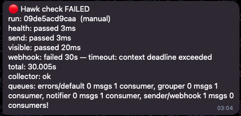

# hawk-synthetic-monitor

Synthetic monitoring for [Hawk](https://hawk.so). Periodically sends a test event through the pipeline (collector, processing, API view, webhook delivery), times each stage, identifies the failing component, and alerts via Telegram.

## Quick start

Requires a running Hawk instance (collector, API, workers: `default`, `grouper`, `notifier`, `webhook`) and a project. The service does not create accounts or projects; `scripts/bootstrap.sh` handles initial setup.

```sh
# 1. Prepare a project and an env file (local Hawk with the API in NODE_ENV=e2e, see "Hawk setup")
WEBHOOK_MODE=mongo HAWK_COMPOSE_DIR=/path/to/hawk.mono OUT=.env scripts/bootstrap.sh

# 2. Add the Telegram URL (optional) and start
echo 'TELEGRAM_NOTIFY_URL=https://notify.bot.codex.so/u/XXXX' >> .env
docker compose up -d --build

# 3. Look
curl localhost:8080/healthz
curl -X POST localhost:8080/run          # run a check now, returns the stage-by-stage result
curl localhost:8080/runs                 # history
curl localhost:8080/stats                # success rate for 24 h and 7 d
curl localhost:8080/metrics              # Prometheus
```

Without Docker: `go run ./cmd/monitor` with the same variables exported (see `.env.example`).

## API

| Path | Port | Purpose |
|---|---|---|
| `GET /healthz` | 8080 | liveness of the monitor itself (does not depend on Hawk) |
| `POST /run` | 8080 | run a check now |
| `GET /runs?limit=N` | 8080 | latest results (default 20, max 100) |
| `GET /stats` | 8080 | counts and success rate for the last 24 h and 7 days |
| `GET /metrics` | 8080 | Prometheus metrics, prefix `hawk_monitor_` |
| `POST /webhook` | 8085 | receiver for Hawk's webhook notifications |

Only one check runs at a time. Concurrent scheduled ticks are skipped; `POST /run` returns `409`.

## Configuration

Required: `HAWK_COLLECTOR_URL`, `HAWK_API_URL`, `HAWK_PROJECT_ID`, `HAWK_INTEGRATION_TOKEN`, `HAWK_EMAIL`, `HAWK_PASSWORD`. Defaults are in `.env.example`:

| Variable | Default | |
|---|---|---|
| `MONITOR_INTERVAL` | `10m` | time between checks |
| `MONITOR_RUN_TIMEOUT` | `90s` | the whole check |
| `MONITOR_HEALTH_TIMEOUT` / `MONITOR_SEND_TIMEOUT` | `10s` / `15s` | per stage |
| `MONITOR_VISIBLE_TIMEOUT` / `MONITOR_WEBHOOK_TIMEOUT` | `30s` / `30s` | counted from sending |
| `MONITOR_POLL_INTERVAL` | `500ms` | how often the API is polled for the event |
| `MONITOR_MAX_ATTEMPTS` / `MONITOR_RETRY_BACKOFF` | `3` / `1s` | attempts per stage for transient errors, pause between them |
| `MONITOR_CLEANUP` | `false` | delete the test event after a passed check |
| `MONITOR_HTTP_ADDR` / `MONITOR_WEBHOOK_ADDR` | `:8080` / `:8085` | listen addresses |
| `MONITOR_DB_PATH` | `monitor.db` (`/data/monitor.db` in Docker) | SQLite history |
| `TELEGRAM_NOTIFY_URL` | empty | `@codex_bot` webhook URL (send `/notify_start` to the bot in a chat); empty disables alerts |
| `HAWK_HEALTH_URL` | derived from the collector URL | collector health endpoint for the `health` stage |
| `HEARTBEAT_URL` | empty | where to POST after every finished check (see the watchdog); with the compose watchdog use `http://watchdog:8090/ping` |
| `WATCHDOG_TIMEOUT` / `WATCHDOG_CHECK_EVERY` | `25m` / `30s` | settings of the `watchdog` service (silence limit, how often it checks) |
| `RABBITMQ_MGMT_URL` | empty | RabbitMQ management API (e.g. `http://rabbitmq:15672`); set it to collect diagnostics on failures |
| `RABBITMQ_USER` / `RABBITMQ_PASSWORD` / `RABBITMQ_VHOST` | `guest` / empty / `/` | management API credentials |
| `RABBITMQ_QUEUES` | `errors/default,grouper,notifier,sender/webhook` | queues on the event path to report |

### Hawk setup

Prerequisites:
1. Project, integration token, and API credentials (email/password; access tokens live 15 minutes, the client logs in again on its own).
2. Notification rule: `ONLY_NEW`, channel `webhook`, pointing to `/webhook` on port 8085.
3. Network reachability between monitor and Hawk.

Rule modes (`scripts/bootstrap.sh`, `WEBHOOK_MODE`):
- `api`: GraphQL (`createProjectNotificationsRule`), requires public HTTP(S) URL on port 80 or 443.
- `mongo`: direct MongoDB update, allowing private IPs (`http://host.docker.internal:8085/webhook`).

`bootstrap.sh` is idempotent. `signUp` returns credentials only with `NODE_ENV=e2e`; otherwise create user and project manually. Collector caches tokens up to 30 s; notifier caches rules up to 60 s.

## How it works

### Pipeline

```
health   GET  collector /health               redis and mongo reported healthy
send     POST collector /                     event with a unique title, accepted (HTTP 200, error:false)
visible  POST API /graphql                    the event with that title shows up in the project's events
webhook  POST <monitor>/webhook (from Hawk)   Hawk's notifier delivers the event to our receiver
```

- `visible` and `webhook` run in parallel after `send`, each with its own deadline from event dispatch.
- Webhook receiver subscribes before `send` so early notifications are not missed.
- If `health` or `send` fails, subsequent stages are marked as `skipped`.
- Stages retry transient errors (5xx, 429, network) within stage budget, recording duration, attempts, and failure code (`timeout`, `unavailable`, `not_found`, `error`).

| Failed stage | Meaning |
|---|---|
| `health` | collector, Redis or its MongoDB are down |
| `send` | the collector rejected or did not answer (bad token 400, limit 402, 429, 5xx, network) |
| `visible` | no event in the API in time: stuck somewhere in default/grouper/MongoDB, or the API is down |
| `webhook` | no notification arrived in time (waited for in parallel with `visible`): notifier, `sender/webhook` worker, or the receiver is unreachable from Hawk |

### Architecture

```
cmd/monitor            entry point: config -> app.Run
cmd/watchdog           separate small service that alerts when heartbeats stop
internal/
  entity/              domain types: RunResult, StageResult, Alert, Stats. Imports nothing.
  usecase/             Check (the scenario) and its ports: HawkGateway, DeliveryInbox,
                       ResultRepo, Notifier, Cleaner, Observer, Clock
  adapter/
    hawk/              collector + GraphQL client implementing HawkGateway and Cleaner
    webhook/           HTTP receiver and in-memory inbox implementing DeliveryInbox
    sqlite/            history, implementing ResultRepo (pure Go driver, no CGO)
    telegram/          alerts through the @codex_bot webhook, implementing Notifier
    metrics/           Prometheus collectors, implementing Observer
    heartbeat/         heartbeat ping, implementing Heartbeat
  controller/
    scheduler/         runs a check every interval
    http/              /healthz /run /runs /stats /metrics
  watchdog/            the independent watcher behind cmd/watchdog
  config/              environment variables -> Config
  app/                 composition root: builds adapters, injects them, runs servers
```

Usecases depend only on interfaces declared in `internal/usecase/`, tested with fakes and no network (`internal/usecase/check_test.go`). Adapters use `httptest` servers.

## Diagnostics and observability

When `RABBITMQ_MGMT_URL` is set, failures capture collector health and queue stats (`errors/default`, `grouper`, `notifier`, `sender/webhook`), stored in `GET /runs` (`diagnostics`) and sent to Telegram (`!` indicates 0 consumers):

```
collector: ok
queues: errors/default 0 msgs 1 consumer, grouper 0 msgs 1 consumer, notifier 0 msgs 1 consumer, sender/webhook 4 msgs 0 consumers!
```

Requires a user with `monitoring` tag: `rabbitmqctl add_user ...; rabbitmqctl set_user_tags <user> monitoring` (`guest` only works from localhost). When unset, snapshot is skipped. Cleanup result is in `cleanup`.



### Observability and watchdog

```sh
docker compose --profile observability up -d   # Prometheus :9090 and Grafana :3001 (anonymous viewer), dashboard "Hawk synthetic monitor" is provisioned
docker compose --profile watchdog up -d        # watchdog :8090
```


- **Metrics** (`/metrics`, prefix `hawk_monitor_`): runs by status, stage outcomes, duration, event latencies, and last run/success timestamps (fixed label sets).
- **Heartbeat & watchdog**: with `HEARTBEAT_URL` set, monitor POSTs `{status, run_id, finished_at}` after every finished check. `watchdog` (`cmd/watchdog`) alerts Telegram if no ping arrives within `WATCHDOG_TIMEOUT` (default 25 m) and on recovery.
- Wiring: set `HEARTBEAT_URL=http://watchdog:8090/ping` and `TELEGRAM_NOTIFY_URL` in `.env`, then run `docker compose --profile watchdog up -d`. Test: stop monitor (`docker compose stop monitor`), wait for timeout, then restart.

## Operations and limitations

- **Scope**: verifies pipeline up to Hawk's webhook delivery (covers notifier and `sender/webhook`). Hawk delivery to Telegram is not tested; Telegram is used solely for monitor alerts. UI is tested via GraphQL API, not a browser.
- **Failures**: a timeout shows where the event stopped being observable, not which worker failed.
- **Alerts**: sends one alert on failure and one on recovery. Pending recovery flag is in-memory (lost on restart before delivery). Alert or storage failures are logged in `reporting_errors` and do not alter the check verdict.
- **Polling**: queries latest 20 events via GraphQL; use a dedicated low-traffic project.
- **Duplicates**: retrying `send` on lost response may create duplicate events in Hawk (grouped by title, no duplicate notification).
- **Webhook security**: receiver matches project ID and random run ID from event title.
- **API security**: `POST /run` has no authentication; compose binds port 8080 to `127.0.0.1`. Use a reverse proxy with authentication before exposing.
- **Watchdog deployment**: collocated watchdog cannot detect host failure; run on a separate host (`entrypoint: watchdog`, requires `TELEGRAM_NOTIFY_URL`).

### Development

```sh
make check   # format check, golangci-lint, go test -race
make fmt     # gofumpt + gci
make hooks   # pre-commit hook running the same checks
```

CI runs lint and `go test -race` on every push.
